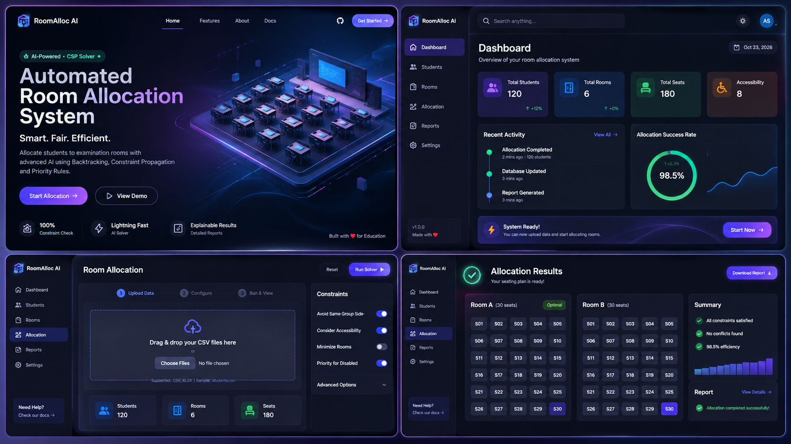
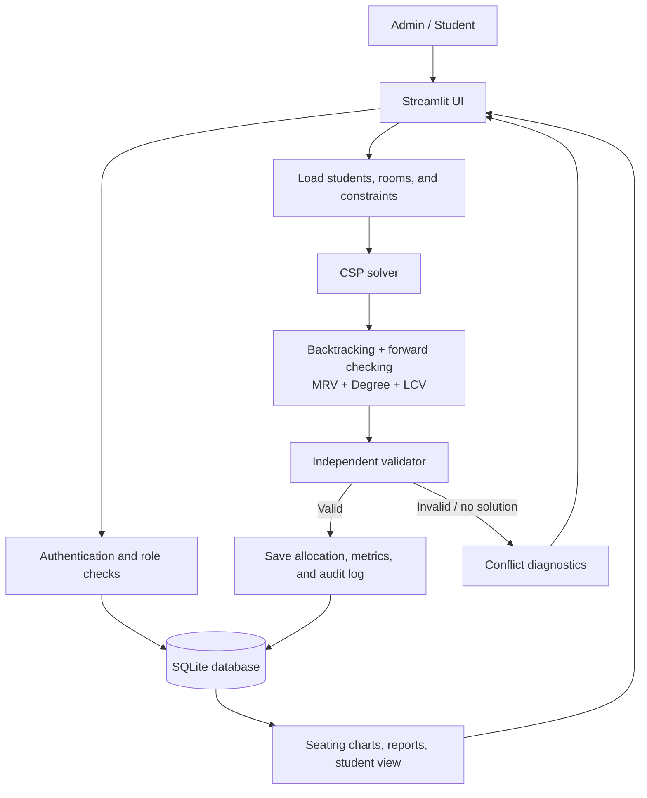

# RoomAlloc AI

**Constraint-based examination seating with accessible allocation, explainable failures, and separate admin/student views.**

[](https://www.python.org/) [](https://streamlit.io/)

RoomAlloc AI assigns students to seats while enforcing room capacity, group non-adjacency, accessibility, and restricted-pair constraints. It models seating as a **Constraint Satisfaction Problem (CSP)** instead of using random assignment.

## Preview



<sub>Design reference only; this is not a live application screenshot.</sub>

## Features

- **CSP solver:** backtracking, forward checking, MRV, Degree Heuristic, and LCV.
- **Constraint checks:** unique seats, group non-adjacency, accessibility, and restricted pairs.
- **Explainable failures:** diagnostics when a valid arrangement cannot be found.
- **Admin console:** manage students, rooms, constraints, allocations, and reports.
- **Student portal:** private seating details and hall-ticket information.
- **Data management:** SQLite persistence, CSV validation, password hashing, role-based access, and audit logs.
- **Reports:** visual seating grids, analytics, and printable charts.

## System design



**Allocation flow:** load inputs → build seat domains → search for a valid assignment → validate hard constraints → save a valid result, or report why allocation failed.

More detail: [Architecture](docs/ARCHITECTURE.md) · [Data dictionary](docs/DATA_DICTIONARY.md) · [Security](docs/SECURITY.md)

## Run locally

Requires Python 3.11+.

```bash
git clone https://github.com/adityasinghr651/Room-Allocation-System.git
cd Room-Allocation-System
python -m venv .venv
```

Activate the environment:

```powershell
# Windows PowerShell
.venv\Scripts\Activate.ps1
```

```bash
# macOS / Linux
source .venv/bin/activate
```

Install dependencies and launch:

```bash
pip install -r requirements.txt
streamlit run app.py
```

Open [http://localhost:8501](http://localhost:8501).

## Tests

```bash
python -m pytest -v
```

The test suite covers solver constraints, validation, authentication, database operations, and CSV handling. Run it locally to verify the current checkout.

## Project structure

```text
app.py                 # Streamlit entry point
app/                   # Login, admin/student views, styling
src/                   # CSP solver, constraints, validator, diagnostics, database
data/                   # SQLite database and synthetic CSV samples
tests/                  # Automated tests
docs/                   # Architecture, data dictionary, security notes
assets/reference/      # UI design reference
requirements.txt       # Python dependencies
```

> **Deployment note:** Demo records/accounts are for local testing. Change demo passwords before sharing the app. Local SQLite files may not persist on ephemeral hosting; use persistent storage for deployments that need durable data.
