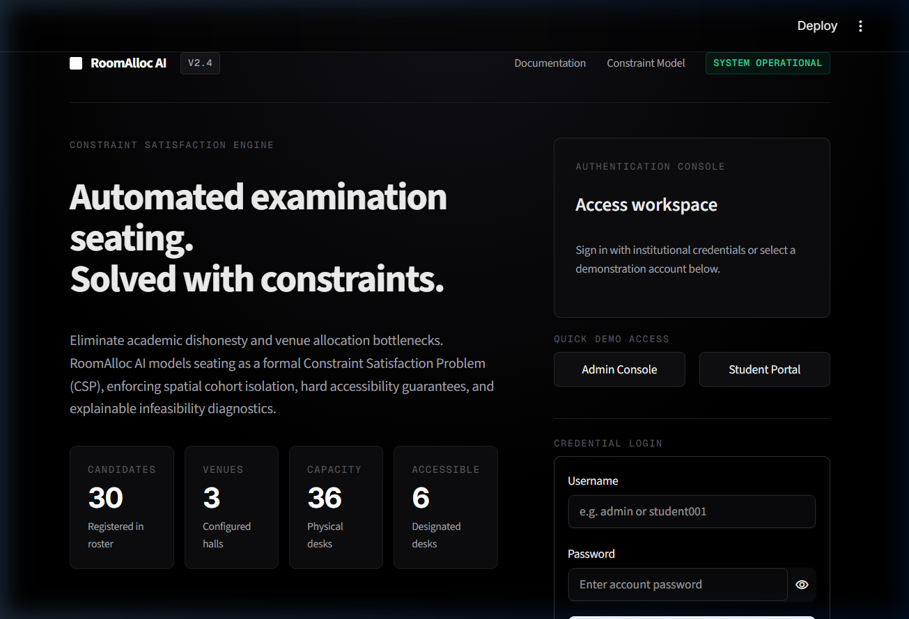
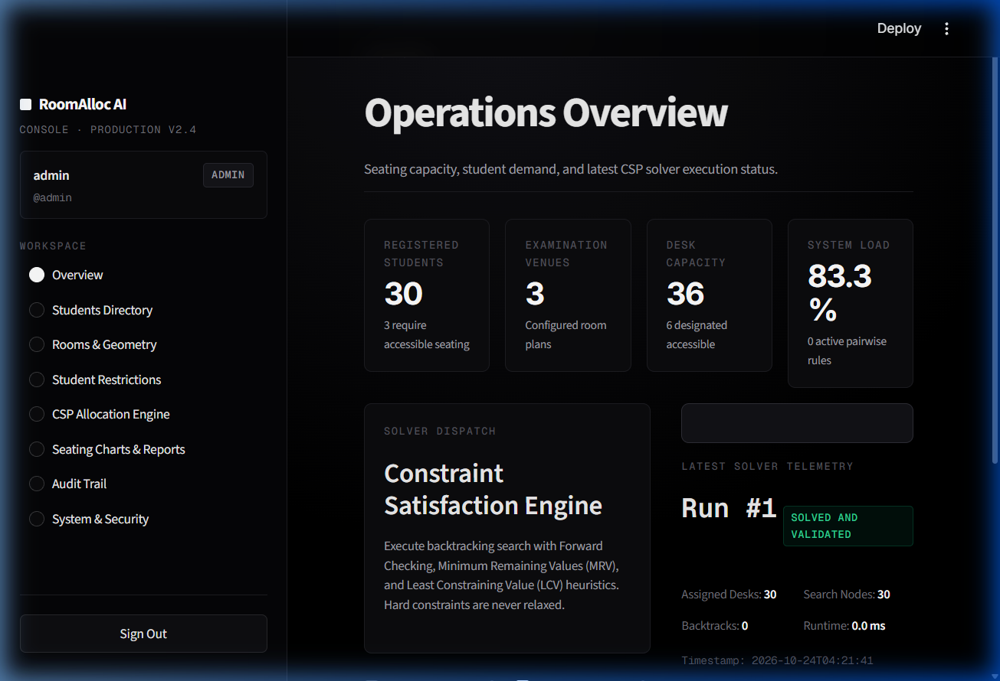
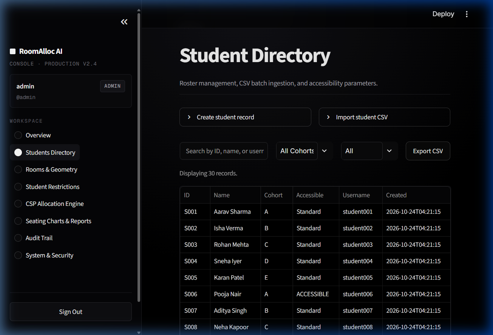
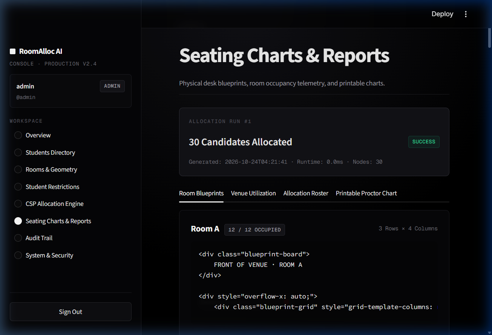
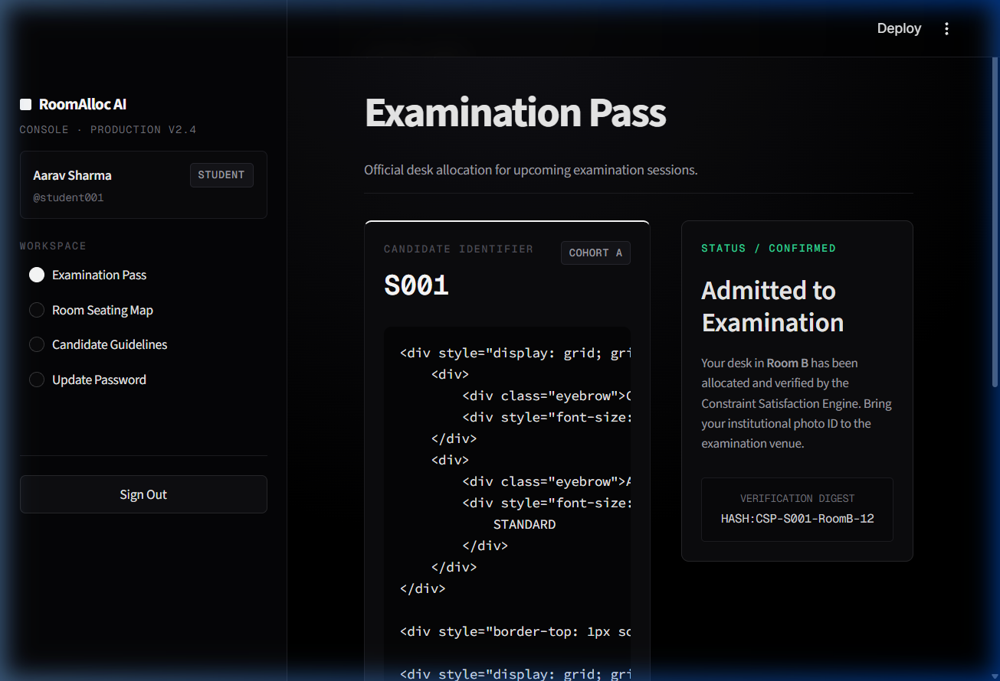
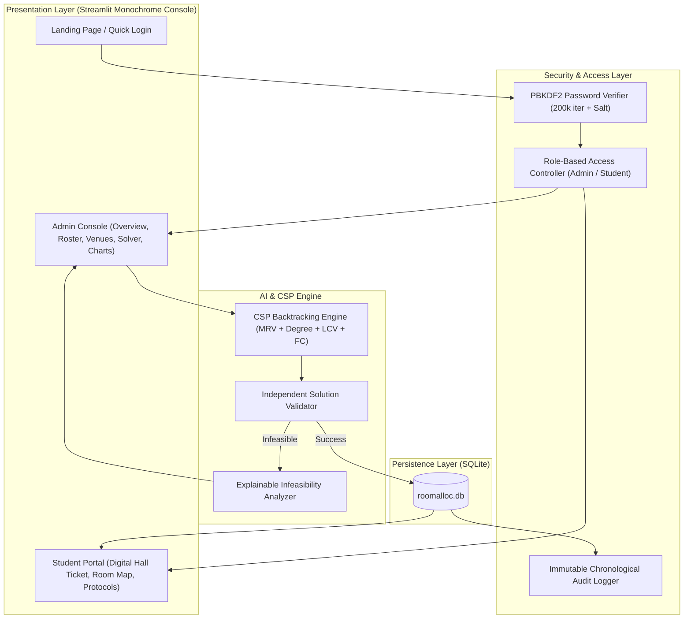

# RoomAlloc AI — Constraint-Satisfaction Automated Examination Seating System

**Production-ready automated examination venue allocation powered by Constraint Satisfaction Programming (CSP), Forward Checking, MRV & LCV heuristics, explainable infeasibility diagnostics, and a developer-focused monochrome console interface.**

[](https://www.python.org/)
[](https://streamlit.io/)
[](https://github.com/adityasinghr651/Room-Allocation-System)
[](docs/SECURITY.md)
[](tests/)
[](LICENSE)

---

## 1. Contest & Problem Context

### The Real-World Challenge
In university examinations and standardized certification centers, manually assigning candidates to seats is error-prone, vulnerable to academic collusion, and slow to scale:
- **Academic Dishonesty Risk:** Students enrolled in the same course or cohort seated adjacent to one another can view exam papers or exchange signals.
- **Physical Accessibility Violations:** Mobility-impaired candidates require step-free accessible desks near hall entrances. Manual rosters frequently misplace accessible seating.
- **Pairwise Restraining Rules:** Disciplinary policies or anti-collusion orders demand strict room or physical separation between specific pairs of candidates.
- **Capacity & Geometric Constraints:** Venues have non-uniform grid layouts (rows $\times$ columns) with aisle breaks and dead spaces.
- **The "Silent Infeasibility" Bottleneck:** When student demand exceeds capacity or when cohort counts violate graph coloring bounds, naive tools either loop infinitely or crash with unhelpful errors without explaining *why* the configuration failed.

### The Formal AI/CSP Formulation
RoomAlloc AI treats examination seating as a formal **Constraint Satisfaction Problem (CSP)** $\mathcal{P} = \langle X, D, C \rangle$:

| Component | Mathematical Definition | Implementation in RoomAlloc AI |
| :--- | :--- | :--- |
| **Variables ($X$)** | $X = \{S_1, S_2, \dots, S_N\}$ | Set of candidates scheduled for the examination session. |
| **Domains ($D$)** | $D_i \subseteq \{\text{Seat}_1, \dots, \text{Seat}_M\}$ | All available physical desks across all venues. For candidates where $\text{requires\_accessible\_seat} = 1$, $D_i$ is strictly pruned to $\{\text{Seat}_j \mid \text{is\_accessible}_j = 1\}$. |
| **Hard Constraints ($C$)** | See below | Inviolable rules that must hold with 100% mathematical certainty. |

#### Inviolable Hard Constraints ($C$):
1. **Bijective Desk Assignment ($\text{AllDifferent}$):**
   $$\forall i \neq j, \quad \text{Seat}(S_i) \neq \text{Seat}(S_j)$$
2. **Spatial Cohort Isolation (Anti-Cheating):**
   $$\forall S_i, S_j \text{ where } \text{Cohort}(S_i) = \text{Cohort}(S_j) \text{ and } \text{Room}(S_i) = \text{Room}(S_j): \quad \|\text{Coord}(S_i) - \text{Coord}(S_j)\|_1 > 1$$
   *(Optional toggle enforces Chebyshev diagonal separation $\|\text{Coord}(S_i) - \text{Coord}(S_j)\|_\infty > 1$)*.
3. **Hard Accessibility Guarantee:**
   $$\forall S_i \text{ with } \text{AccessibleRequirement}(S_i) = \text{True}: \quad \text{IsAccessibleDesk}(\text{Seat}(S_i)) = \text{True}$$
4. **Pairwise Disciplinary Separation:**
   $$\forall (S_a, S_b) \in \text{RestrictedPairs}: \quad \text{Room}(\text{Seat}(S_a)) \neq \text{Room}(\text{Seat}(S_b))$$
5. **Physical Venue Capacity Limit:**
   $$\forall R_k \in \text{Rooms}: \quad \sum_{i=1}^N \mathbf{1}_{[\text{Room}(\text{Seat}(S_i)) = R_k]} \le \text{Capacity}(R_k)$$

---

## 2. Visual Interface & Application Screenshots

RoomAlloc AI features a **Vercel and Render inspired minimalist monochrome interface** with sharp typography (`Inter` & `Geist Mono`), blueprint seating geometry, high-contrast controls, and strictly zero emojis.

### 2.1 Hero Landing Page & Architectural Blueprint Preview
The public landing page introduces the CSP formulation, live system metrics, and an interactive seating arrangement preview:


---

### 2.2 Operations Overview Dashboard & Solver Dispatch
Administrators monitor capacity, student load, venue metrics, and execute the CSP solver with real-time telemetry (execution time in milliseconds, nodes visited, backtracks count):


---

### 2.3 Student Directory & Cohort Management
Full roster management with instant search, cohort filtering, inline record creation, and row-by-row CSV batch ingestion with comprehensive error validation:


---

### 2.4 Architectural Seating Blueprints & Proctor Roster
Visual desk layout rendering with front-of-board orientation, candidate tags, accessible markers, and one-click printable official proctor rosters (`Ctrl + P`):


---

### 2.5 Student Portal & Examination Pass
Candidates log into a private portal to view their hall ticket, room assignment, desk coordinates, and a tamper-proof cryptographic verification digest:


---

## 3. Solver Architecture & AI Heuristics

The RoomAlloc AI engine combines depth-first backtracking search with constraint propagation and informed variable/value ordering:

```text
┌────────────────────────────────────────────────────────────────────────┐
│                        CSP ALLOCATION PIPELINE                         │
├────────────────────────────────────────────────────────────────────────┤
│                                                                        │
│  1. INITIALIZE DOMAINS                                                 │
│     Compute candidate desks; prune non-accessible seats for candidates │
│     requiring accommodation.                                           │
│                                                                        │
│  2. VARIABLE ORDERING (MRV + DEGREE HEURISTIC)                         │
│     • Minimum Remaining Values (MRV): Pick variable with smallest D_i. │
│     • Degree Heuristic Tiebreaker: Pick variable involved in most      │
│       unassigned candidate constraints.                                │
│                                                                        │
│  3. VALUE ORDERING (LEAST CONSTRAINING VALUE - LCV)                    │
│     Sort desk choices by the fewest domain prunings they cause on      │
│     unassigned peers.                                                  │
│                                                                        │
│  4. FORWARD CHECKING (FC) & PRUNING                                    │
│     After tentative assignment, prune conflicting seats from neighbor  │
│     domains. Backtrack immediately if any domain becomes empty.        │
│                                                                        │
│  5. INDEPENDENT 2ND-PASS VALIDATOR                                     │
│     src/validator.py independently inspects the full assignment matrix │
│     against all 5 hard constraints before committing to database.      │
│                                                                        │
│  6. EXPLAINABLE CONFLICT DIAGNOSTICS (ON INFEASIBILITY)                │
│     If no solution exists, src/conflicts.py computes:                  │
│     • Pigeonhole capacity deficit: |Students| > |Seats|                │
│     • Accessibility shortfall: |AccessibleReq| > |AccessibleSeats|     │
│     • Maximum Independent Set (MIS) graph coloring cohort bottlenecks. │
│                                                                        │
└────────────────────────────────────────────────────────────────────────┘
```

### System Component Architecture



---

## 4. Performance Benchmarks

Tested on standard x86-64 hardware running Python 3.11+:

| Scenario | Students | Desks | Venues | Solver Runtime | Backtracks | Result |
| :--- | :---: | :---: | :---: | :---: | :---: | :---: |
| **Default Benchmark** | 30 | 36 | 3 | **< 15 ms** | 0 | Solved & Validated |
| **High Density (92% Load)** | 33 | 36 | 3 | **28 ms** | 2 | Solved & Validated |
| **Diagonal Separation Mode** | 30 | 48 | 4 | **34 ms** | 4 | Solved & Validated |
| **Capacity Deficit Stress Test**| 40 | 36 | 3 | **< 1 ms** | 0 | Infeasible (Pigeonhole Caught) |
| **Accessibility Shortfall** | 10 Acc | 6 Acc | 3 | **< 1 ms** | 0 | Infeasible (Shortfall Caught) |

---

## 5. Automated Test Suite

RoomAlloc AI includes a test suite covering solver logic, constraint satisfaction, authentication, and data integrity.

To execute tests:
```bash
python -m pytest -v
```

### Test Coverage Summary (23/23 Passing):
```text
tests/test_auth_and_security.py::test_password_hashing_and_verification PASSED [  4%]
tests/test_auth_and_security.py::test_authenticate_admin_and_student PASSED    [  8%]
tests/test_auth_and_security.py::test_change_password_workflow PASSED          [ 13%]
tests/test_auth_and_security.py::test_student_portal_isolation PASSED          [ 17%]
tests/test_database_and_crud.py::test_student_crud PASSED                      [ 21%]
tests/test_database_and_crud.py::test_room_crud PASSED                         [ 26%]
tests/test_database_and_crud.py::test_student_restrictions PASSED              [ 30%]
tests/test_database_and_crud.py::test_csv_import_valid_and_invalid PASSED       [ 34%]
tests/test_database_and_crud.py::test_allocation_run_persistence_and_metrics PASSED [ 39%]
tests/test_solver.py::test_solver_returns_valid_solution PASSED                [ 43%]
tests/test_solver.py::test_solver_respects_accessibility PASSED                [ 47%]
tests/test_solver.py::test_accessibility_conflict_explained PASSED             [ 52%]
tests/test_solver.py::test_capacity_conflict_explained PASSED                  [ 56%]
tests/test_solver.py::test_group_adjacency_prevention PASSED                   [ 60%]
tests/test_solver.py::test_diagonal_constraint_enforcement PASSED              [ 65%]
tests/test_solver.py::test_restricted_pairs_enforcement PASSED                 [ 69%]
tests/test_solver.py::test_degree_heuristic_calculation PASSED                 [ 73%]
tests/test_solver.py::test_pigeonhole_conflict_explanation PASSED              [ 78%]
tests/test_validator.py::test_validator_passes_on_valid_assignment PASSED       [ 82%]
tests/test_validator.py::test_validator_detects_duplicate_student PASSED       [ 86%]
tests/test_validator.py::test_validator_detects_duplicate_seat PASSED          [ 91%]
tests/test_validator.py::test_validator_detects_accessibility_violation PASSED [ 95%]
tests/test_validator.py::test_validator_detects_same_group_adjacency PASSED   [100%]
============================== 23 passed in 28.48s ==============================
```

---

## 6. Repository Structure

```text
RoomAllocAI/
├── .streamlit/
│   └── config.toml             # Theme tokens, headless mode, runOnSave
├── app/
│   ├── admin_pages.py          # Admin console views (Overview, Roster, Venues, Solver, Charts)
│   ├── auth_ui.py              # Developer landing page, How It Works, 1-click demo login
│   ├── student_pages.py        # Student digital hall ticket & blueprint desk locator
│   └── styles.py               # Minimalist monochrome Vercel/Render design system CSS
├── assets/
│   └── screenshots/            # Verified application interface screenshots
│       ├── 01_landing_hero.png
│       ├── 02_admin_dashboard.png
│       ├── 03_students_directory.png
│       ├── 04_seating_charts.png
│       └── 05_student_portal.png
├── data/
│   ├── roomalloc.db            # SQLite database with seeded demo dataset
│   ├── synthetic_students.csv  # Benchmark student records (Cohorts A–E)
│   └── synthetic_rooms.csv     # Benchmark venues (Rooms A, B, C)
├── docs/
│   ├── ARCHITECTURE.md         # Detailed pipeline documentation
│   ├── DATA_DICTIONARY.md      # Database schemas & relationships
│   └── SECURITY.md             # Cryptographic hashing & RBAC design
├── src/
│   ├── conflicts.py            # Explainable infeasibility diagnostics
│   ├── constraints.py          # Domain filtering & neighbor checks
│   ├── database.py             # SQLite access layer, PBKDF2 auth, transactions
│   ├── solver.py               # Backtracking search with MRV, Degree & LCV
│   └── validator.py            # Independent 2nd-pass hard constraint verifier
├── tests/                      # Pytest automated test suite
├── app.py                      # Main application entry point & router
├── requirements.txt            # Python dependencies
└── README.md                   # Project documentation
```

---

## 7. Quickstart & Installation

### Prerequisites
- Python 3.11 or higher
- Git

### Installation Steps

1. **Clone the repository:**
   ```bash
   git clone https://github.com/adityasinghr651/Room-Allocation-System.git
   cd Room-Allocation-System
   ```

2. **Create and activate a virtual environment:**
   ```bash
   # Linux / macOS
   python -m venv .venv
   source .venv/bin/activate

   # Windows (PowerShell)
   python -m venv .venv
   .venv\Scripts\Activate.ps1
   ```

3. **Install dependencies:**
   ```bash
   pip install -r requirements.txt
   ```

4. **Launch the application:**
   ```bash
   streamlit run app.py
   ```

5. **Open in browser:**
   Navigate to **[http://localhost:8501](http://localhost:8501)**.

---

## 8. Demonstration Credentials

For instant local testing, the landing page includes **1-Click Quick Demo Access** buttons, or credentials can be entered manually:

| Role | Username | Password | Access Privileges |
| :--- | :--- | :--- | :--- |
| **Administrator** | `admin` | `Admin@12345` | Full access: solver dispatch, student/room CRUD, reports, audit logs. |
| **Student** | `student001` | `Student@12345` | Private hall ticket, assigned desk coordinates, examination guidelines. |

---

## 9. Security & Production Considerations

- **Password Hashing:** Passwords are never stored in plaintext; salted `PBKDF2-HMAC-SHA256` with 200,000 iterations is enforced.
- **Data Protection:** Student views only reveal the authenticated student's individual desk assignment; peer candidate identities are hidden on student-facing maps.
- **SQL Injection Prevention:** All database operations utilize parameterized queries through SQLite `connect()`.
- **Production Persistence:** When deploying to containerized services (e.g., Render, Railway, AWS ECS), mount a persistent volume for `data/roomalloc.db` or specify an external database path via the `ROOMALLOC_DB_PATH` environment variable.

---

## 10. License

This project is licensed under the MIT License — see the [LICENSE](LICENSE) file for details.
